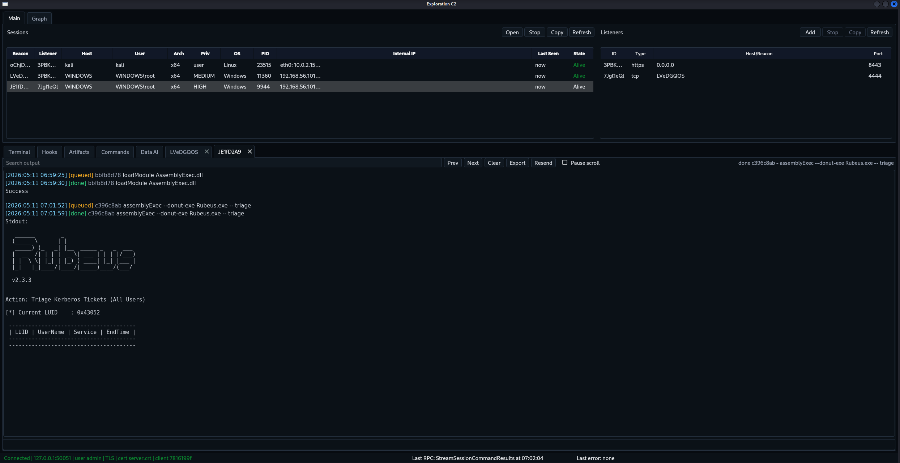
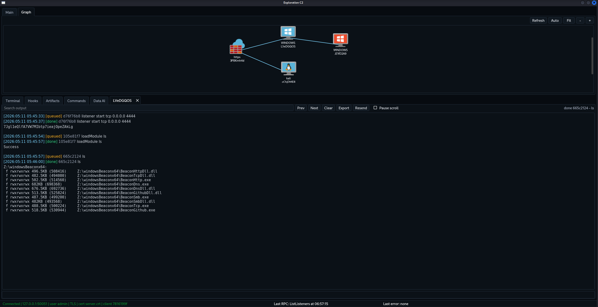
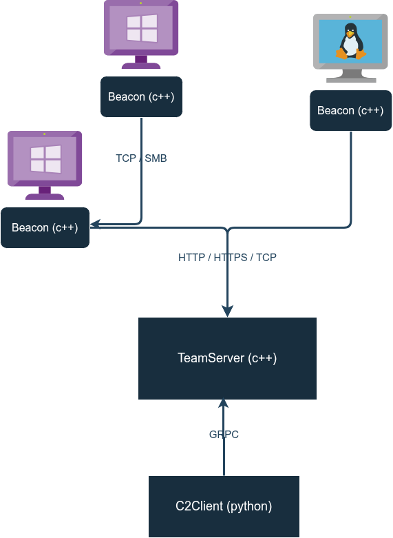

# Exploration C2 Framework

<p align="center">
  
</p>

## Overview

**Exploration** is a modular Command and Control framework for red team operations.

This repository contains:

- C++ TeamServer
- Python Client
- Release packaging for Windows assets from [C2Implant](https://github.com/maxDcb/C2Implant)
- Release packaging for Linux assets from [C2LinuxImplant](https://github.com/maxDcb/C2LinuxImplant)

## Look And Feel

<p align="center">
  
</p>

<p align="center">
  
</p>

## Architecture

The TeamServer manages listeners and sessions. The Python Client talks to the TeamServer through gRPC.

Supported listener channels:

- `TCP`
- `SMB`
- `HTTP`
- `HTTPS`

<p align="center">
  
</p>

## Repository Layout

```text
protocol/     .proto source and generated gRPC build rules
teamServer/   TeamServer runtime and gRPC implementation
C2Client/     Python client package and UI
core/         shared C++ components
packaging/    release bundle assembly and validation
integration/  runtime staging and integration tests
docs/         build, release, CI/CD, and integration notes
```

## Quick Start

Install both the TeamServer and GUI client on Linux or WSL:

```bash
curl -fsSL https://github.com/maxDcb/C2TeamServer/releases/latest/download/install.sh | bash
```

The installer uses `~/.local/Exploration` by default. It creates a unique TLS certificate
and admin password, and shows that password once. It uses uv for the client dependencies.

```bash
exploration server start
exploration server status
exploration client
exploration server stop
```

Install just one component, or use a local bundle:

```bash
curl -fsSL https://github.com/maxDcb/C2TeamServer/releases/latest/download/install.sh | bash -s -- --server-only
curl -fsSL https://github.com/maxDcb/C2TeamServer/releases/latest/download/install.sh | bash -s -- --client-only --hostname teamserver.example.org --ca-cert ./trust.crt
bash install.sh --bundle ./Release.tar.gz --prefix "$HOME/.local/Exploration"
```

See [installation and updates](docs/install.md) for certificate options, commands and
persistent files.

## Docker

```bash
docker build -t exploration-teamserver .
docker run --rm -it \
  --name exploration-teamserver \
  -p 50051:50051 \
  -p 80:80 \
  -p 443:443 \
  -p 8443:8443 \
  exploration-teamserver
```

Use a local release bundle:

```bash
docker run --rm -it \
  -v "$PWD/Release:/opt/teamserver/Release:ro" \
  -p 50051:50051 \
  exploration-teamserver
```

## Build And Release Docs

- [Build and tests](docs/build.md)
- [Installation and updates](docs/install.md)
- [Release packaging](docs/release.md)
- [Implant asset contract](docs/implants.md)
- [CI/CD contract](docs/ci-cd.md)
- [Integration runtime](docs/integration.md)

## Blog Series

[Building a Modern C2](https://maxdcb.github.io/BuildingAModernC2/)

- Part 0: Setup and basic usage
- Part 1: TeamServer and architecture
- Part 2: GUI and operator workflows
- Part 3: Beacons and listeners
- Part 4: Modules
